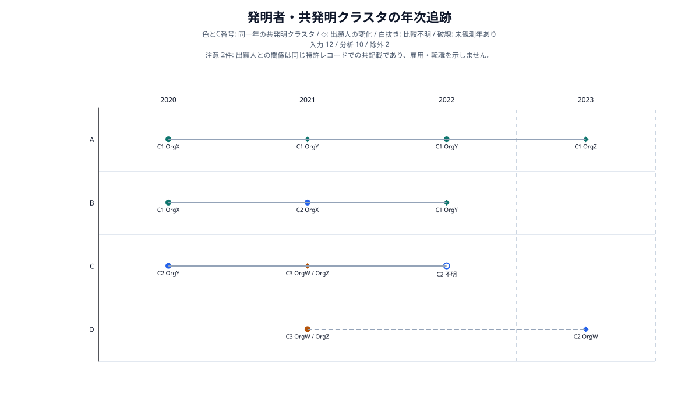
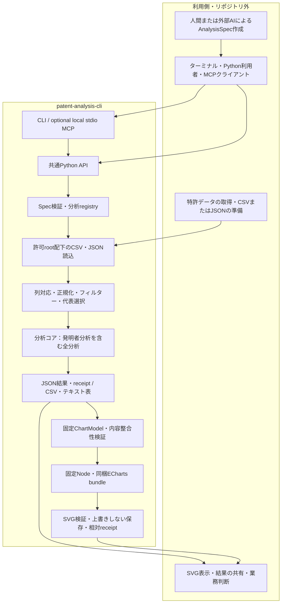
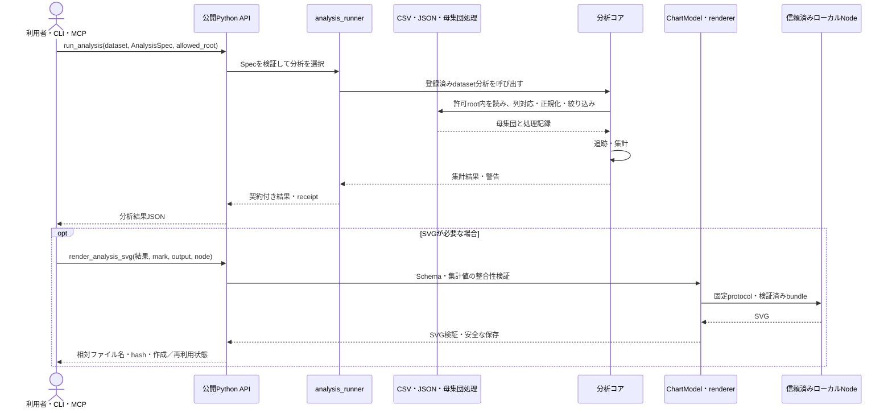
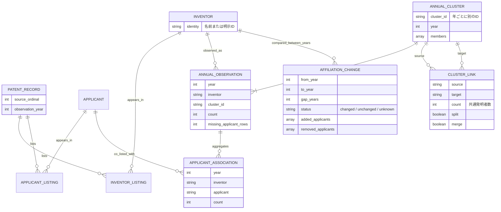

# patent-analysis-cli

ローカルの特許CSVまたはJSONを、明示した列対応と条件で決定論的に集計し、JSON、CSV・テキストの集計表、固定形式のSVGとして出力するツールです。Python API・CLI・local stdio MCPは同じ計算コアを使います。自然言語の解釈や外部特許データの取得は行いません。

| 入口 | 現在の範囲 |
| --- | --- |
| Python API / CLI | <!--var:analysis_count-->28<!--/var-->分析。分析の選び方は[分析カタログ](docs/analysis-catalog.md) |
| local stdio MCP | <!--var:mcp_analysis_count-->28<!--/var-->分析・<!--var:mcp_tool_count-->6<!--/var-->ツール。[設定と呼び出し例](docs/mcp.md) |
| SVG | 固定形式の<!--var:mark_count-->28<!--/var-->種類。[収録しているSVGグラフ](#収録しているsvgグラフ)と`capabilities --json`を参照。配色は4種から選択。Windows x64 / macOS arm64/x86_64、**Node.js 22.19.0（対応アーキテクチャ）** |
| 集計単位 | 既存<!--var:population_analysis_count-->17<!--/var-->種類のv2分析で`records` / `earliest`。新しい発明者分析は[専用仕様](docs/inventor-analysis.md)。旧Rankingはレコード単位のみ |

Python 3.14で動作するローカル実行専用のパッケージです。入力・出力契約と安全性の境界は[SECURITY.md](SECURITY.md)、配布物の検証方法は[リリース手順](docs/release.md)を参照してください。

## インストール

**Python 3.14系（3.14以上・3.15未満）が必要**です。既存の文字処理はUnicode 16.0.0を要求するため、インストール条件も検証済みの3.14系に限定しています。SVGを使わなければNodeやnpmは不要です。依存の取得にはインストール時の通信が必要ですが、インストール後の分析処理は外部サービスを呼びません。

公開リポジトリを取得し、そのルートで実行します。

```text
git clone https://github.com/Nagi-Inaba/patent-analysis-cli.git
cd patent-analysis-cli
```

### Windows / PowerShell

```powershell
py -3.14 -m venv .venv
$pythonExe = (Resolve-Path .venv\Scripts\python.exe).Path
& $pythonExe -m pip install .
& $pythonExe -m patent_analysis capabilities --json
```

### macOS / Linux

```bash
python3.14 -m venv .venv
.venv/bin/python -m pip install .
.venv/bin/python -m patent_analysis capabilities --json
```

通常利用に`[dev]`、editable install、rendererの`node_modules`は不要です。wheelから導入する場合も、Windowsでは`& $pythonExe -m pip install ./patent_analysis_cli-0.2.0-py3-none-any.whl`、macOS / Linuxでは`.venv/bin/python -m pip install ./patent_analysis_cli-0.2.0-py3-none-any.whl`のように作成したvenvを指定します。既存の同名versionを更新するときは、新しいvenvを使い、releaseのcommitとwheelのSHA-256を確認してください。

MCPを使う場合だけ、Windowsでは`& $pythonExe -m pip install ".[mcp]"`、macOS / Linuxでは`.venv/bin/python -m pip install ".[mcp]"`を実行します。利用するクライアントには、そのvenvのPythonまたは`patent-analysis-mcp`の絶対パスを設定します。

Intel MacでMCPを導入する場合、`cryptography`のソースビルドが必要になることがあります。その場合は[公式のmacOSビルド要件](https://cryptography.io/en/latest/installation/#building-cryptography-on-macos)に従い、Xcode Command Line Tools、Rust、OpenSSLを用意してください。必要なバージョンのwheelがない環境で、`--only-binary`を指定して旧版へ戻さないでください。

新しい発明者分析<!--var:inventor_analysis_count-->10<!--/var-->種類には`.[inventor]`、MCPと併用する場合には`.[inventor,mcp]`をインストールします。人物ID、技術構成、協働グループ、引用、関係先変化の根拠を扱います。[全<!--var:inventor_analysis_count-->10<!--/var-->種類の合成例と入力条件](docs/inventor-analysis.md)を参照してください。

## 最初の集計

すべて合成データです。既存<!--var:shared_example_count-->17<!--/var-->分析は`examples/advanced/patents.csv`を共用し、発明者追跡は専用の合成CSVを使います。[例の一覧](examples/analysis-catalog.json)がCSV・spec・期待結果との対応を管理します。

```powershell
$env:PATENT_ANALYSIS_ALLOWED_ROOT = (Resolve-Path examples).Path
& $pythonExe -m patent_analysis inspect advanced/patents.csv --json
& $pythonExe -m patent_analysis analyze advanced/patents.csv --spec basic/ranking.json --json
& $pythonExe -m patent_analysis analyze advanced/patents.csv --spec advanced/collaboration-network.json --json
```

macOS / Linuxでは`export PATENT_ANALYSIS_ALLOWED_ROOT="$(pwd -P)/examples"`と設定し、`$pythonExe`の代わりに`.venv/bin/python`を使います。

`inspect`は列名・件数等のメタデータだけを返し、セル値・サンプル行・絶対パスは返しません。`analyze`の結果には入力由来のラベルと集計値が含まれます。外部AIへ渡す範囲は利用者側で判断してください。元のCSV・JSONは変更しません。

### 特許JSONを入力する

拡張子`.json`のUTF-8ファイルは、提示された特許objectを1件として読みます。同じ形のobjectを配列にすると複数件を分析できます。

```json
[
  {
    "application_no": "SAMPLE-APPLICATION-001",
    "title": "サンプル発明A",
    "application_date": "2024-01-01",
    "publication_date": "2025-01-01",
    "group": ["分類A", "分類B"],
    "applicants": ["サンプル出願人A"],
    "inventors": ["サンプル発明者A", "サンプル発明者B"],
    "sections": {"abstract": "サンプル要約"}
  }
]
```

objectのキーが列名になります。入れ子objectは`sections.abstract`のようなドット区切り列へ展開し、`applicants`や`inventors`のscalar配列は`|`区切りのmulti-value cellとして既存の正規化へ渡します。複数objectで欠けた列は空文字になります。objectを含む配列、重複キー、NaN/Infinity、展開後に同名になるキーは拒否します。詳細な型変換と上限は[入力契約](docs/contracts.md#json-input)を参照してください。

上記を`examples/patents.json`として保存すると、`group`列を使う同梱のRanking specでCSVと同じように実行できます。相対パスは`PATENT_ANALYSIS_ALLOWED_ROOT`を基準に解決されるため、入力とspecの両方を設定済みの`examples`配下に置きます。

```powershell
& $pythonExe -m patent_analysis inspect patents.json --json
& $pythonExe -m patent_analysis analyze patents.json --spec basic/ranking.json --json
```

期待する集計本体は[expected-aggregates.json](examples/expected-aggregates.json)の各分析IDにあります。Rankingは応答の`result`、v2分析は`data`と比較します。同梱例の入力と条件に対応する固定結果です。

## 発明者のクラスタと出願人の変化を追う

`inventor-tracking.v1`で、年別の共発明クラスタ、クラスタの分裂・合流、発明者ごとの出願人の変化を追跡できます。名前または明示的な発明者IDを使い、未観測年と出願人欄の欠損を区別します。出願人は特許上の共記載であり、勤務先・転職を認定するものではありません。

```powershell
& $pythonExe -m patent_analysis analyze inventor-tracking/patents.csv --spec inventor-tracking/spec.json --format text
```

SVGには`inventor-tracking-svg.v1`を指定します。横軸は年、縦軸は発明者、色とC番号は同一年のクラスタです。菱形で出願人の変化、破線で未観測期間を示します。1回の追跡は20発明者・12暦年までで、上位だけに切り捨てる処理は行いません。[入力条件・集計の意味・実行例](docs/inventor-tracking.md)を参照してください。



## Specを事前検証する

分析前にSpecだけを検証する場合は、`validate-spec`を使います。CSVを読まず、Schemaと実装済み条件を検証します。列が実データに存在するか、実データが集計上限に収まるかは`analyze`で確認します。

```powershell
& $pythonExe -m patent_analysis validate-spec basic/growth.json --json
& $pythonExe -m patent_analysis schema growth-parameters-v1.schema.json --json
```

`validate-spec -`は標準入力に対応します。ファイル入力は`PATENT_ANALYSIS_ALLOWED_ROOT`配下が必要です。標準入力と`schema`にはroot設定は不要です。Schema名は`capabilities --json`にあるパスのファイル名を指定します。

## ファミリー代表単位で集計する

```powershell
& $pythonExe -m patent_analysis analyze family/patents.csv --spec family/composition.json --json
```

同梱の5行から4代表行を選び、出願人の所属件数はA=1、B=1、C=2になります。処理順は**フィルター → ファミリー代表選択 → 分析固有の集計**です。同じIDの属性を合算したり、IDを推定したりしません。空欄IDは個別に残します。

代表の日付を比較できる場合だけ最も早い暦日を使い、同日・不正または欠損日付の比較は元の行順で決めます。最初の日付が不明な代表を後の有効日付で置き換えません。詳細は[ファミリー仕様](docs/family-population.md)を参照してください。

## CSV・テキストの集計表を出力する

<!--var:analysis_count-->28<!--/var-->分析すべてで`--format csv`または`--format text`を使えます。Nodeは不要です。

```powershell
& $pythonExe -m patent_analysis analyze advanced/patents.csv --spec basic/timeline.json --format csv
& $pythonExe -m patent_analysis analyze advanced/patents.csv --spec advanced/collaboration-network.json --format text
```

CSVはUTF-8でstdoutへ返し、`analysis_id`と`table`で分析・表種別を区別します。年別系列は年ごとに1行、Networkはnodesとedgesを出力します。`--json`とは併用できません。`--include-context`を付けると、Spec・母集団・警告・receiptを含む分析文書全体も添付できます。列一覧とエスケープ規則は[表出力](docs/table-export.md)を参照してください。

## WindowsでSVGを作る

信頼できるローカルのNode 22.19.0 x64と、既存の絶対パスの出力ディレクトリが必要です。同梱済みの描画資産を使うため、利用時にnpm installやビルドは行いません。

```powershell
$nodeExe = (Get-Command node.exe -ErrorAction Stop).Source
$output = Join-Path $env:TEMP ("patent-svg-" + [guid]::NewGuid().ToString("N"))
New-Item -ItemType Directory -Path $output | Out-Null
$result = & $pythonExe -m patent_analysis analyze advanced/patents.csv --spec basic/ranking.json --json
if ($LASTEXITCODE -ne 0) { throw "Analysis failed; do not render the error response" }
$result | & $pythonExe -m patent_analysis render --analysis - --mark ranking-svg.v1 --output $output --node $nodeExe --json
```

同じ`$result`・mark・出力先で最後のコマンドを再実行すると、同一SVGを`reused`として返します。異なる内容で既存ファイルを上書きしません。成功応答の`svg`は出力先からの相対ファイル名です。

## macOSでSVGを作る

Python 3.14がインストール済みで、SVGにはNode.js 22.19.0（実行するmacOSアーキテクチャに対応）が必要です。`node -p 'process.execPath'`でNodeの実体を解決するため、Homebrew・asdf・nvmのsymlinkを含む環境でも使用できます。入力・出力・Nodeのpathにsymlink componentがある場合は拒否されるため、出力先は`pwd -P`で物理pathへ正規化します。この例は既に作成した`.venv`を使い、global toolをインストールしません。

```bash
nodeExe="$(node -p 'process.execPath')"
output="$(mktemp -d -t patent-svg)"
output="$(cd "$output" && pwd -P)"
export PATENT_ANALYSIS_ALLOWED_ROOT="$(pwd -P)/examples"
result=$(.venv/bin/python -m patent_analysis analyze advanced/patents.csv --spec basic/ranking.json --json) || exit $?
printf '%s' "$result" | .venv/bin/python -m patent_analysis render --analysis - --mark ranking-svg.v1 --output "$output" --node "$nodeExe" --json
```

SVGは読み上げ用のタイトルと、入力行数・分析対象件数・警告件数を持ちます。数値と条件の詳細には`--include-context`付きの集計表を添えてください。すべての支援技術での操作やWCAG適合を保証するものではありません。

配色は`render --palette`で`standard`（既定）・`colorblind`・`monochrome`・`high-contrast`から選べます。未指定なら従来と同じ出力です。`matrix-bubble-svg.v1`だけは`--value-labels shown`でバブルに件数を表示できます。MCPのrenderでは`palette`・`value_labels`を指定します。各paletteの内容と制約は[配色パレット](docs/contracts.md#配色パレット)を参照してください。

Linuxでは集計・JSONを利用できますが、公開SVG経路は引き続き非対応です。Nodeのバージョンやプラットフォーム検査を迂回しないでください。mark一覧は次節と`capabilities --json`にあります。応用11分析の詳細は[SVG仕様](docs/advanced-rendering.md)、発明者分析の描画は[発明者分析](docs/inventor-analysis.md)を参照してください。

## 収録しているSVGグラフ

`render --mark`に指定できるmarkは<!--var:mark_count-->28<!--/var-->種類です。分析ごとに描けるグラフは固定で、任意のEChartsオプションは渡せません。正本は`capabilities --json`の`render_marks`です。`series-line-svg.v1`はTimeline・Growth・Concentrationの3分析が共用し、`inventor-mobility-evidence.v1`はJSON・表のみでmarkがありません。発明者の`inventor-tracking`以外の9種には`.[inventor]`が必要です。

| 分類 | グラフ | mark | 分析ID |
| --- | --- | --- | --- |
| 基本 | ランキング | `ranking-svg.v1` | `ranking.v1` |
| 基本 | マトリクス（バブル） | `matrix-bubble-svg.v1` | `matrix.v1` |
| 基本 | マトリクス（ヒートマップ） | `matrix-heatmap-svg.v1` | `matrix.v1` |
| 基本 | 折れ線 | `series-line-svg.v1` | `timeline.v1`・`growth.v1`・`concentration.v1` |
| 基本 | 積み上げ棒 | `series-stacked-bar-svg.v1` | `timeline.v1` |
| 基本 | 構成比（横棒） | `composition-bar-svg.v1` | `composition.v1` |
| 基本 | 構成比（円） | `composition-pie-svg.v1` | `composition.v1` |
| 基本 | ライフサイクル | `points-bubble-svg.v1` | `lifecycle.v1` |
| 応用 | 成長四象限 | `growth-quadrant-svg.v1` | `growth-quadrant.v1` |
| 応用 | 初回・最終観測年 | `entry-exit-svg.v1` | `entry-exit.v1` |
| 応用 | 被引用マップ | `citation-svg.v1` | `citation.v1` |
| 応用 | 選択セルの内訳 | `matrix-composition-svg.v1` | `matrix-composition.v1` |
| 応用 | 新規参入者 | `new-entrants-svg.v1` | `new-entrants.v1` |
| 応用 | グループ間の差分 | `compara-svg.v1` | `compara.v1` |
| 応用 | 共起マトリクス | `cooccurrence-svg.v1` | `cooccurrence.v1` |
| 応用 | 協業ネットワーク | `collaboration-network-svg.v1` | `collaboration-network.v1` |
| 応用 | 固有項目 | `uniqueness-svg.v1` | `uniqueness.v1` |
| 応用 | 共有項目 | `shared-involvement-svg.v1` | `shared-involvement.v1` |
| 発明者 | 年次追跡 | `inventor-tracking-svg.v1` | `inventor-tracking.v1` |
| 発明者 | 共発明ネットワーク | `inventor-network-svg.v1` | `inventor-network.v1` |
| 発明者 | 発明者中心の関係図 | `inventor-ego-network-svg.v1` | `inventor-ego-network.v1` |
| 発明者 | 発明者×技術分野 | `inventor-technology-svg.v1` | `inventor-technology.v1` |
| 発明者 | 活動履歴 | `inventor-activity-svg.v1` | `inventor-activity.v1` |
| 発明者 | 協働グループの変遷 | `inventor-cluster-flow-svg.v1` | `inventor-cluster-flow.v1` |
| 発明者 | 技術類似度 | `inventor-similarity-svg.v1` | `inventor-similarity.v1` |
| 発明者 | 活動量と引用 | `inventor-impact-svg.v1` | `inventor-impact.v1` |
| 発明者 | 出願人との関係変化 | `inventor-mobility-svg.v1` | `inventor-mobility.v1` |
| 発明者 | 法人間フロー | `inventor-mobility-flow-svg.v1` | `inventor-mobility-flow.v1` |

マトリクス（バブル）は2軸の組み合わせ件数を円の大きさで表します。specの`pie_role`を指定すると、バブルの中がその項目の構成比の円グラフになり、右に凡例が付きます（例: `basic/matrix-pie.json`）。選択した1セルの内訳だけを見るには`matrix-composition.v1`を使います。[分析の選び方](docs/analysis-catalog.md)も参照してください。

## Python API

```python
from pathlib import Path
from patent_analysis.api import run_analysis

root = Path("examples").resolve(strict=True)
result = run_analysis(
    "advanced/patents.csv",
    (root / "basic/composition.json").read_bytes(),
    allowed_root=root,
)
print(result["data"])
```

`run_analysis()`は`.csv`と`.json`を受け付けます。互換名`run_analysis_csv()`、旧Rankingの`analyze_csv()`、汎用描画入口`render_analysis_svg()`、`render_ranking_svg()`も保持しています。APIとCLIの契約・エラーは[contracts.md](docs/contracts.md)を参照してください。

## 構成と処理の流れ

アーキテクチャ図です。このリポジトリはローカルCSV・JSONの検査、集計、描画と各adapterを実装します。特許データの取得、自然言語からのSpec作成、GUI、結果の共有先の判断は利用側の役割です。



次はUMLシーケンス図です。分析結果を保存・再利用でき、SVG生成は必要なときだけ呼び出します。描画runtimeはWindows x64またはmacOS arm64/x86_64と、Node 22.19.0を使います。



発明者追跡の論理ER図です。**入力dataset・集計JSONの関係を表すもので、永続DBやDBテーブルは実装していません。** 発明者と出願人の関係は同じ特許レコードへの記載から集計します。



詳しい境界は[architecture.md](docs/architecture.md)、入力・出力の契約は[contracts.md](docs/contracts.md)を参照してください。

## 入力と安全な利用範囲

CLIのファイル入力は、信頼した起動側が指定する`PATENT_ANALYSIS_ALLOWED_ROOT`配下に限定します。dataset・specの相対パスは現在の作業ディレクトリではなく、このrootが基準です。MCPの承認済みrootは別設定で、入力・出力rootを互いに重ならない既存ディレクトリとして指定します。

CSVはカンマ区切りのUTF-8、UTF-8 BOM、UTF-16 LE/BE BOMに対応し、file size上限は300 MiBです。dataset JSONはUTF-8（先頭のUTF-8 BOM 1個は許容）に対応し、whole-document parseのためfile size上限は32 MiBです。両形式とも100,000行、1,000列、2,000,000セルが上限です。上限は推奨メモリ容量の保証ではありません。AnalysisSpecのJSONは最大2 MiBで、各分析に別の展開件数・文字列上限があります。dataset JSONと同様、AnalysisSpecとOperationPlanのJSONも先頭のUTF-8 BOM 1個をencoding signatureとして無視し、値の中のBOMは対象外です。

| CLI終了コード | 意味 |
| --- | --- |
| 0 | 成功 |
| 2 | 契約違反 |
| 3 | 入力・root・パス・読込エラー |
| 4 | 引数不備 |
| 5 | ローカル描画環境を利用できない |
| 6 | 出力先の競合 |

JSON出力はstdoutに1オブジェクトです。エラーを成功結果として後段へ渡さないでください。trusted-local描画はOSサンドボックスではありません。任意SQL・任意JavaScript・任意のECharts options、外部特許DB、remote MCPは提供しません。高度なWindows隔離は現在の保証に含めません。[SECURITY.md](SECURITY.md)が安全性と残余リスクの説明です。

## 開発・配布準備

```bash
python -m pip install --require-hashes -r requirements/mcp-2.2.0.lock
python -m pip install -e '.[dev,inventor]' build
python -m pytest -q -p no:cacheprovider
python -m ruff check --no-cache src tests scripts
python -m build
```

CIは既存のWindowsとLinuxに加えて`macos-15`（arm64）と`macos-15-intel`でtest、lint、renderer build、dependency auditを実行します。Windowsはskip 0件、macOSはWindows固有の`tests/test_access.py`に限ってskipを許可し、native SVG testsはすべて実行します。配布確認では別venvへwheelを非editable installし、source tree外からCLIとMCPを検証します。

## ライセンス

本体は[Apache License 2.0](LICENSE)で提供します。同梱rendererの第三者コンポーネントには、[THIRD_PARTY_NOTICES.txt](src/patent_analysis/renderer/THIRD_PARTY_NOTICES.txt)に記載した各ライセンスが適用されます。配布metadataの`License-Expression`は、本体と同梱コードを合わせた`Apache-2.0 AND MIT AND BSD-3-Clause AND 0BSD`です。

[リリース手順](docs/release.md) / [アーキテクチャ](docs/architecture.md) / [変更履歴](CHANGELOG.md) / [開発への参加](CONTRIBUTING.md)
